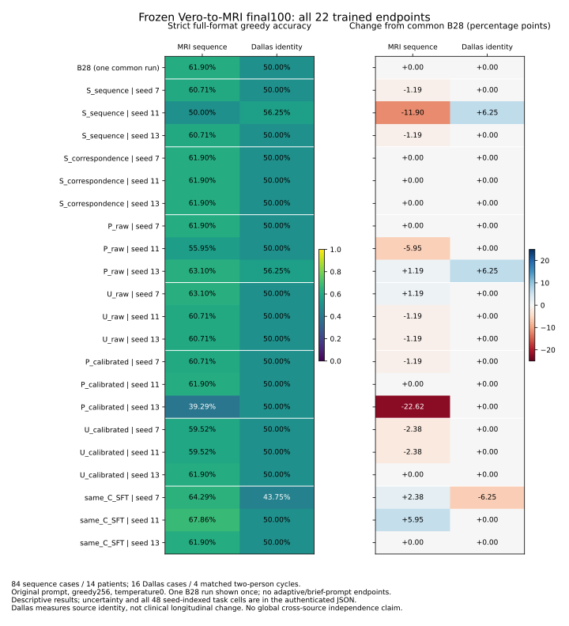

# Vero-to-MRI：原始22-checkpoint冻结测试实际结果

研究标签：`PRIMARY_VERO_TRANSFER`。证据：`OBSERVED` 原生模型运行与保存输出；`REPRODUCED` 独立 Codex 数值复算。本报告没有新增模型训练、选择最佳seed或调整最终测试协议。

## 实际完成与连续性

- 原始18个RL臂和3个SFT对照已全部完成并逐臂独立核验。它们是从共同B28起点出发的独立对照，不能串成一个连续训练模型。
- 正式评估为B28一次、18个RL端点、3个SFT端点，共22个模型、2,200次真实图像生成；每模型100题。B28的一份输出在矩阵里复用为三个seed索引基线，不是三次独立运行。
- 队列于2026-10-18T08:54:21.054601Z启动、10:48:33.471233Z自然退出0，实际总耗时6,852.416632秒，即1小时54分12秒。该时间包括加载、监测、持久化和阶段切换，不是纯GPU时间；未用Git时间估计。
- 所有模型保持原始system/question、greedy、temperature0、max_tokens256及严格评分。每条输出持久化，模型串行运行。本轮最终评估与CPU分析均无optimizer更新。
- 分析前，独立审查确认22个退出凭证、全部输出/闭合日志哈希、模型/adapter/精度/输入/提示/图像绑定及每模型100条唯一覆盖。
- B28、Adam52、Adam56、Adam60及其Adam/RNG/历史检查点均保存。Adam60不属于正式原始22模型清单，没有被偷偷加入正式比较。

矩阵沿用的 `actual_test_execution:false` 表示保存结果适配函数本身没有启动模型；本次22个原生运行由另行认证的实际队列退出凭证证明，不能把该字段解释成“没有执行最终评估”。原始矩阵保持不改写。

## 正式准确率：全部seed，不择优

测试包含84个序列问题（14名患者，每人3层面×2模态）和16个Dallas身份对应问题（8名患者、4个两人匹配周期）。下表依次列出seed7/11/13。主宏平均对两个任务等权；本批输出中native task accuracy与严格full-format accuracy完全一致。

| 方法 | 序列正确数／84，seed7/11/13 | Dallas正确数／16，seed7/11/13 | 三seed等任务宏平均 | 宏平均观察范围 |
|---|---|---|---:|---:|
| B28共同起点，一次输出复用 | 52 / 52 / 52 | 8 / 8 / 8 | 55.95% | 不构成seed重复 |
| 序列单任务RL | 51 / 42 / 51 | 8 / 9 / 8 | 54.61% | 53.13–55.36% |
| Dallas单任务RL | 52 / 52 / 52 | 8 / 8 / 8 | 55.95% | 55.95–55.95% |
| 比例混合RL，raw | 52 / 47 / 53 | 8 / 8 / 9 | 56.20% | 52.98–59.67% |
| 均匀混合RL，raw | 53 / 51 / 51 | 8 / 8 / 8 | 55.75% | 55.36–56.55% |
| 比例混合RL，calibrated | 51 / 52 / 33 | 8 / 8 / 8 | 51.98% | 44.64–55.95% |
| 均匀混合RL，calibrated | 50 / 50 / 52 | 8 / 8 / 8 | 55.16% | 54.76–55.95% |
| 同数据SFT | 54 / 57 / 52 | 7 / 8 / 8 | 56.30% | 54.02–58.93% |

完整逐seed×逐任务的48个单元、24个arm/seed摘要和患者／周期配对差值区间见 `results/ORIGINAL22_FINAL100_ACTUAL_MATRIX_V1.json`。独立审查未调用原始score/matrix/bootstrap函数，仅复用冻结答案解析器，从2,200条实际预测独立重建全部计数和48个2,000次bootstrap区间，误差小于1e-12。

## 类别召回、无效生成和成本

下表是严格full-format正确数，各列分母固定为42个FLAIR、42个增强T1、8个same、8个different；除以分母即类别recall。完整44个模型／任务计数表、混淆矩阵和时间字段见 `results/ORIGINAL22_FINAL100_CLASS_FORMAT_COST_SUPPLEMENT_V1.json`。

| 模型端点 | FLAIR／42 | 增强T1／42 | same／8 | different／8 | 序列无效／84 |
|---|---:|---:|---:|---:|---:|
| B28 | 42 | 10 | 0 | 8 | 0 |
| rl:S_sequence:7 | 39 | 12 | 8 | 0 | 0 |
| rl:S_sequence:11 | 2 | 40 | 8 | 1 | 0 |
| rl:S_sequence:13 | 40 | 11 | 0 | 8 | 0 |
| rl:S_correspondence:7 | 42 | 10 | 0 | 8 | 0 |
| rl:S_correspondence:11 | 42 | 10 | 0 | 8 | 0 |
| rl:S_correspondence:13 | 42 | 10 | 0 | 8 | 0 |
| rl:P_raw:7 | 39 | 13 | 8 | 0 | 0 |
| rl:P_raw:11 | 42 | 5 | 0 | 8 | 0 |
| rl:P_raw:13 | 38 | 15 | 8 | 1 | 0 |
| rl:U_raw:7 | 31 | 22 | 0 | 8 | 0 |
| rl:U_raw:11 | 42 | 9 | 0 | 8 | 0 |
| rl:U_raw:13 | 41 | 10 | 0 | 8 | 0 |
| rl:P_calibrated:7 | 41 | 10 | 0 | 8 | 0 |
| rl:P_calibrated:11 | 42 | 10 | 0 | 8 | 0 |
| rl:P_calibrated:13 | 17 | 16 | 8 | 0 | 38 |
| rl:U_calibrated:7 | 40 | 10 | 0 | 8 | 0 |
| rl:U_calibrated:11 | 40 | 10 | 0 | 8 | 0 |
| rl:U_calibrated:13 | 42 | 10 | 0 | 8 | 0 |
| sft:7 | 38 | 16 | 5 | 2 | 0 |
| sft:11 | 34 | 23 | 0 | 8 | 0 |
| sft:13 | 37 | 15 | 8 | 0 | 0 |

- B28的FLAIR recall为100%，增强T1为23.81%；Dallas全部回答different，50%准确率不能视为学会对应。
- 部分端点改变了类别偏好。例如均匀raw seed7的FLAIR正确31/42、增强T1为22/42，整体只比B28多正确1/84；这不足以证明更好的视觉利用。
- 比例calibrated seed13有38条无效序列输出，其中37条真实length截断；另外21个模型没有无效答案，也没有形成稳定跨seed收益。生成失败是真实问题，但不能解释全部训练效果。
- 全部2,200次生成累计53,650个实际token；记录的调用耗时合计5,252.81秒。调用计时包括generate_record内部的资源回调／可能等待，排除初始模型加载与外部JSON写入，不能称为纯GPU时间。整个串行队列实际耗时6,852.42秒。
- 总计37条length截断、38条invalid、0条format0.5。严格与native正确率在本批48个矩阵单元相同；没有放宽解析器。

## 证据支持的结论

1. **本次有限本地实现没有证实均匀多任务GSPO稳定优于共同起点。** raw均匀宏平均55.75%，B28为55.95%；三个seed分别有小幅上升、下降、下降。更新次数或均匀采样本身不代表迁移成功。
2. **个别正结果不能择优报告。** 比例raw seed13为序列53/84、Dallas9/16、宏平均59.67%；另两个seed宏平均55.95%和52.98%。序列相对B28差值+1.19个百分点，患者配对区间[-4.76,+7.14]；Dallas+6.25个百分点，周期区间[0,+18.75]。这不支持稳定算法优势，也不授权据此选择续训父模型。
3. **保留明显负结果。** 比例calibrated seed13序列33/84，比B28少19题，差值-22.62个百分点，患者配对区间[-32.14,-14.29]；序列专科seed11为42/84。48个seed索引任务单元中有11个负差值。
4. **SFT同样没有形成跨seed的稳定多任务收益。** 序列端点54/57/52，但Dallas7/8/8；最高观察序列端点不等同于预先选择的可靠新模型。
5. 上述区间是冻结的逐任务配对cluster percentile bootstrap，不是同时覆盖全部对比的区间，没有多重比较校正；三个训练seed不增加患者数，不能把单个区间当作普遍因果结论。

## 生成修正与视觉学习必须分开

先前已完成的Adam60开发集诊断不变：原提示256→简短推理256，序列10/24→17/24，生成token2,038→1,286（减少36.9%）；FLAIR召回6/12→10/12，增强T1召回4/12→7/12。但主要mean-candidate为15/24→14/24，Dallas same仍0/8，因此没有通过扩大续训的门槛。

这是固定权重的提示／生成收益，不是GSPO权重学习收益，也不属于本报告的正式测试协议。单纯256→512没有救回任何答案。direct-Vero长度惩罚在16,384以内为零与本地256上限确有失配，但原18臂9,144条rollout只有39条触顶，不能认定它是所有学习失败的唯一原因。

已验证的单训练图像对CE梯度会随real/swapped/zero改变，加上冻结视觉特征的分类信息，不支持直接认定基础Qwen缺乏MRI适配能力；这些检查也没有证明完整GSPO rollout/scorer原生数值等价。原始28条单模态序列监督与已有168张配对训练图覆盖差异是真实局限，尚不是单一因果归因。

## 方法冻结、局限与下一步

- 方法与端点在final100影像解码、渲染、模型推理和结果评分前冻结；预存数据配方／获取元数据不属于模型结果选择。原始22模型包括所有预定seed和预算终点，不含adaptive或简短提示端点。不得用本次测试结果选择prompt、reward、sampler、学习率、checkpoint或seed。
- 当前模型是Qwen3-VL-8B-Instruct＋B28 language LoRA上的本地MLX Vero-style GSPO，不是发布的Princeton Vero权重，也未证明与官方veRL实现全面等价。该负结果不能外推为Vero方法普遍无效。
- final100按来源命名空间验证了train/dev/test患者分离；跨来源的全局人员身份独立性仍未验证。Dallas whole-head身份对应不是临床纵向变化或纯脑解剖理解。14名序列患者和4个Dallas周期仍是小样本。
- 正式测试仅生成greedy输出；没有额外运行candidate/no-image/swap测试。不能把此前开发集候选或控制结果冒充最终测试指标。
- 本轮有限训练、生成诊断及正式评估已结束，不追加同配置训练。未来改善阶段必须另行预声明独立患者holdout、有限预算与父checkpoint；保留已训练权重，不从头初始化，也不利用final100继续调参。

## 科研意义的分别判断

- **Scientific significance：** 现有身份与序列任务不足以支持脑MRI疾病、解剖推理或临床纵向变化结论；有价值的是明确记录了生成、类别偏好与视觉判别之间的差别。
- **AI/ML significance：** 尚未证明稳定迁移收益、完整Vero配方等价或新RL算法。结果揭示局部小样本、多任务有效更新和生成接口可能是迁移限制，不能靠增加更新数宣称成功。
- **Experimental significance：** 已完成真实权重更新、完整状态恢复、共同起点对照、全seed冻结终点、2,200次真实图像生成和独立统计复算；负迁移和失败端点均可追溯。

Mission Alignment：主问题是原始Vero-to-MRI跨任务比较；冻结18RL＋3SFT及共同B28；先核验实际完成再评分；保留全部seed与负结果；按患者／匹配周期计算不确定性；本轮无新训练，未来方法须新独立holdout。

独立核验由准确标明身份的Codex执行；当前私有结果 `CROSS_MODEL_REVIEW=NOT_VERIFIED`，没有虚构Claude数值审批。原始影像、患者ID、逐例输出、token数组、权重、optimizer和RNG保留在本地私有路径，不提交Git。
